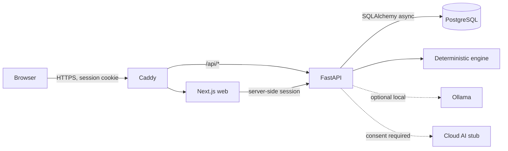

# Auvyren

> Think clearly. Move intentionally.

Auvyren is a **local-first Personal Operating System**: a quiet place to plan work,
pursue goals, build habits, keep knowledge, and make better decisions. It is designed
around **Quiet Intelligence** — deterministic help first, optional local AI second,
and explicitly consented cloud AI last.

**Current status: Phase 7 complete — awaiting approval.** Testing, performance and
accessibility work, security hardening, a production-mode Docker Compose stack, backups,
monitoring and the deployment runbook are implemented and verified. Phase 8 (mobile) has
not started. See the [roadmap](docs/roadmap.md), [implementation
checklist](docs/implementation-checklist.md) and [Phase 7 report](docs/reports/phase-7.md).

## What exists today

| Area | Deliverable |
| --- | --- |
| Monorepo | Next.js 16 web app + FastAPI service + shared operational scripts |
| Brand & UI | Ink/moss/paper identity, self-hosted fonts, tokens, CSS-first motion, Radix primitives and the internal `/design` catalogue |
| Surfaces | Landing, sign-in/sign-up/forgot/reset, dashboard, intelligence, notes, note detail, knowledge search, settings, 404 and error boundaries |
| Productivity API | Tasks, projects, goals, milestones, habits, habit logs, routines, routine steps and calendar events, with ownership and validation |
| Knowledge | Notes CRUD with Markdown-safe rendering, links, search and a knowledge library |
| Intelligence | Deterministic prioritisation, deadlines, goal/habit analysis, patterns, optional Ollama, provenance and deterministic fallback |
| Privacy | Per-provider AI consent, export request/status workflow, account deletion, audit events |
| Frontend | TypeScript, Tailwind CSS v4, App Router, session-aware navigation, honest loading/empty/error/success states |
| Backend | Async FastAPI, Pydantic v2, SQLAlchemy 2 async, RFC 9457 errors, request IDs, CORS, CSP and rate limits |
| Database | PostgreSQL 17, 22 tables, Alembic migrations, trigram search indexes and note-link constraints |
| Quality | 85 API tests, 41 web tests, 21 desktop + 3 mobile Playwright journeys, axe WCAG A/AA scans, performance budgets |
| Delivery | CI workflow, production Compose stack, Caddy TLS edge, Mailpit, backup/restore drill, health/alert script and runbook |

The productivity **API** is complete, but the dashboard still presents an honest empty state
for tasks, goals, habits and calendar; dedicated productivity screens are future frontend
work. No sample data is used anywhere.

## Stack

- **Web:** Next.js 16.4, React 19, TypeScript, Tailwind CSS v4, CSS-first motion
- **API:** Python 3.12+, FastAPI, SQLAlchemy 2 async, Pydantic v2, Alembic
- **Database:** PostgreSQL 17
- **AI:** deterministic engine first; optional local Ollama; cloud adapter is a refusing stub
  until explicitly enabled
- **Delivery:** Node.js 22 standalone output, Docker Compose, Caddy, GitHub Actions

## Prerequisites

- Node.js 22 or newer
- Python 3.12 or newer (3.13 recommended)
- Docker Desktop or Docker Engine with Compose v2
- Git

## Quick start

Run all commands from the repository root.

```bash
# 1. Generate a local .env with strong development credentials
npm run setup:env

# 2. Install frontend dependencies
npm install

# 3. Create the API virtual environment
cd apps/api
python -m venv .venv
# Windows:
.venv\Scripts\python -m pip install -e ".[dev]"
# macOS / Linux:
# .venv/bin/python -m pip install -e ".[dev]"
cd ../..

# 4. Start PostgreSQL
npm run db:up

# 5. Apply migrations
npm run migrate

# 6. Run web + API together
npm run dev
```

Open:

- Web: <http://localhost:3000>
- Design catalogue: <http://localhost:3000/design> (internal, noindex)
- API: <http://localhost:8000>
- API docs: <http://localhost:8000/docs>
- Readiness: <http://localhost:8000/health/ready>

### If port 5432 is already in use

Keep `POSTGRES_PORT` and the port inside `DATABASE_URL` identical. For example, set both
to `5433` in `.env`, then run `npm run db:up` and `npm run migrate`.

### Environment files

- Root `.env` — backend and Docker secrets. Generated by `npm run setup:env`, never committed.
- `apps/web/.env.local` — optional browser-visible configuration only.
- `.env.example` files document every supported value.

**Never place API keys, passwords or other secrets in `NEXT_PUBLIC_*` variables.** They
are embedded in browser JavaScript.

## Production-style stack

The reference deployment runs the API in production mode, Next.js standalone, PostgreSQL,
Caddy with an internal CA and Mailpit:

```bash
docker compose up -d --build
docker compose ps
curl -kfsS https://localhost:8443/health/ready
```

Trust the Caddy root certificate for warning-free browser access; the full procedure,
public-deployment changes, backups, rollback, monitoring and troubleshooting are in the
[deployment runbook](docs/deployment.md).

## Common commands

| Command | Purpose |
| --- | --- |
| `npm run dev` | Run Next.js and FastAPI together |
| `npm run dev:web` / `npm run dev:api` | Run one service |
| `npm run db:up` / `npm run db:down` | Start/stop local PostgreSQL |
| `npm run migrate` | Apply Alembic migrations |
| `npm run check` | Web lint + typecheck + unit tests + API lint + API tests |
| `npm run test:api` | Backend suite (requires PostgreSQL) |
| `npm run test:web` | Vitest/Testing Library suite |
| `npm run test:e2e` / `test:e2e:mobile` | Playwright desktop/mobile journeys |
| `npm run build:web` | Production Next.js build |
| `npm run perf:ci` / `perf:web` | Static / browser performance budgets |
| `npm run stack:up` / `stack:down` / `stack:logs` | Operate the Compose stack |
| `npm run stack:health` | Edge, database, backup and disk health check |
| `npm run db:backup` / `db:restore` | Checksummed PostgreSQL backup/restore |
| `npm run audit:prod` / `audit:dev` | npm dependency audits |
| `npm run format:api` | Format backend with Ruff |

## Repository layout

```text
AUVYREN/
├── .github/workflows/ci.yml  Web, API and browser CI jobs
├── apps/
│   ├── web/                  Next.js App Router frontend
│   │   ├── e2e/              Playwright journeys, axe and security tests
│   │   └── src/
│   │       ├── app/          Routes, layouts, global styles, design catalogue
│   │       ├── components/   UI primitives, layout shells, marketing components
│   │       ├── features/     Feature composition (auth, settings)
│   │       └── lib/          Environment, typed API client, server API bridge
│   └── api/                  FastAPI service
│       ├── app/              Routes, services, models, intelligence engine
│       ├── alembic/          Migration environment and versions
│       └── tests/            PostgreSQL-backed integration suites
├── docs/                     Architecture, operations and phase reports
├── scripts/                  Dev, backup, performance and health scripts
├── Caddyfile                 TLS edge, routing and access logging
├── docker-compose.yml        Production-mode reference stack
└── .env.example              Environment template
```

## Architecture at a glance



All AI calls and provider credentials stay server-side. Deterministic intelligence works
without any AI subscription. The browser never talks directly to Ollama or a cloud AI
provider. Details: [AI architecture](docs/ai-architecture.md).

## Data and security baseline

- PostgreSQL stores all user records with UUID primary keys and timezone-aware timestamps.
- Every user-owned query is scoped by the authenticated user; cross-user access returns 404.
- Opaque server-side sessions, Argon2id password hashing, HttpOnly cookies and CSRF tokens.
  No JWT is stored in the browser.
- A per-request nonce CSP, HSTS over HTTPS and hardening headers protect web documents.
- API errors are RFC 9457 problem details and include a request ID for support.
- CORS is an explicit allowlist; trusted hosts, rate limits and request body limits are set.
- Secrets live only in server-side environment variables; `.env` is gitignored.
- Cloud AI requires explicit, revocable consent and remains disabled by default.
- Backups are checksummed custom PostgreSQL archives; the restore drill is documented.

Full threat model and controls: [security](docs/security.md). Verification evidence:
[Phase 7 security report](docs/reports/phase-7-security.md).

## Documentation

- [Architecture](docs/architecture.md)
- [Database schema](docs/database-schema.md)
- [API architecture](docs/api-architecture.md)
- [Security & authentication strategy](docs/security.md)
- [AI architecture](docs/ai-architecture.md)
- [Design system](docs/design-system.md)
- [Deployment runbook](docs/deployment.md)
- [Incident notes](docs/incidents.md)
- [Development roadmap](docs/roadmap.md)
- [Implementation checklist](docs/implementation-checklist.md)
- [Phase 7 completion report](docs/reports/phase-7.md)
- [Phase 7 performance](docs/reports/phase-7-performance.md),
  [accessibility](docs/reports/phase-7-accessibility.md),
  [security](docs/reports/phase-7-security.md),
  [backup/restore](docs/reports/phase-7-backup-restore.md)

## Phase workflow

Work proceeds strictly in order. Each phase has its own exit criteria, tests and completion
report. The next phase begins only after explicit approval. Phase 8 (mobile) is blocked
until the web application and backend are approved.
