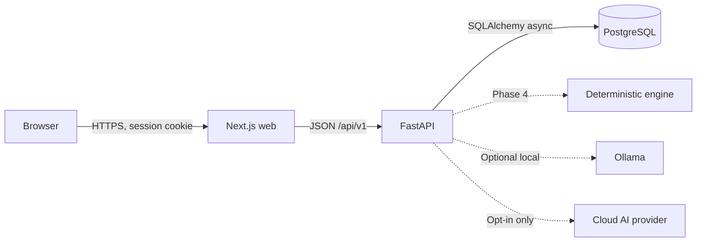

# Auvyren

> Think clearly. Move intentionally.

Auvyren is a **local-first Personal Operating System**: a quiet place to plan work,
pursue goals, build habits, keep knowledge, and make better decisions. It is designed
around **Quiet Intelligence** — deterministic help first, optional local AI second,
and explicitly consented cloud AI last.

**Current status: Phase 0 complete — awaiting approval.** The technical foundation is
implemented and verified. Brand pages, authentication and productivity modules are not
built yet; see the [roadmap](docs/roadmap.md) and [implementation checklist](docs/implementation-checklist.md).

## What exists today

| Area | Phase 0 deliverable |
| --- | --- |
| Monorepo | Next.js 16 web app + FastAPI service + shared scripts |
| Frontend | TypeScript, Tailwind CSS v4, App Router foundation, typed API client, health screen |
| Backend | Async FastAPI, Pydantic settings, RFC 9457 error responses, request IDs, CORS, security headers |
| Database | PostgreSQL 17, SQLAlchemy 2 async models, Alembic migration, 13 tables, indexes and constraints |
| Auth foundation | User/session/reset tables and security strategy documented (endpoints arrive in Phase 2) |
| AI foundation | Provider architecture, deterministic-first plan, Ollama and cloud boundaries documented |
| Quality | 14 backend tests, Ruff, ESLint, TypeScript, production web build |
| Documentation | Architecture, schema, API, security, AI, roadmap, checklist, Phase 0 report |

## Stack

- **Web:** Next.js 16.4, React 19, TypeScript, Tailwind CSS v4, Framer Motion (Phase 1)
- **API:** Python 3.12+, FastAPI, SQLAlchemy 2 async, Pydantic v2, Alembic
- **Database:** PostgreSQL 17
- **AI:** deterministic engine first; optional Ollama; opt-in cloud provider (Phases 4–6)
- **Runtime:** Node.js 22+, Python 3.12+, Docker (local PostgreSQL)

## Prerequisites

- Node.js 22 or newer
- Python 3.12 or newer (3.13 recommended)
- Docker Desktop (for the local PostgreSQL service)
- Git

## Quick start

Run all commands from the repository root.

```bash
# 1. Generate a local .env with strong development credentials
npm run setup:env

# 2. Install frontend dependencies
npm install

# 3. Create the API virtual environment
cd apps/api
python -m venv .venv
# Windows:
.venv\Scripts\python -m pip install -e ".[dev]"
# macOS / Linux:
# .venv/bin/python -m pip install -e ".[dev]"
cd ../..

# 4. Start PostgreSQL
npm run db:up

# 5. Apply migrations
npm run migrate

# 6. Run web + API together
npm run dev
```

Open:

- Web: <http://localhost:3000>
- API: <http://localhost:8000>
- API docs: <http://localhost:8000/docs>
- Readiness: <http://localhost:8000/health/ready>

### If port 5432 is already in use

Keep `POSTGRES_PORT` and the port inside `DATABASE_URL` identical. For example, set both
to `5433` in `.env`, then run `npm run db:up` and `npm run migrate`.

### Environment files

- Root `.env` — backend and Docker secrets. Generated by `npm run setup:env`, never committed.
- `apps/web/.env.local` — optional browser-visible configuration only.
- `.env.example` files document every supported value.

**Never place API keys, passwords or other secrets in `NEXT_PUBLIC_*` variables.** They
are embedded in browser JavaScript.

## Common commands

| Command | Purpose |
| --- | --- |
| `npm run dev` | Run Next.js and FastAPI together |
| `npm run dev:web` / `npm run dev:api` | Run one service |
| `npm run db:up` / `npm run db:down` | Start/stop local PostgreSQL |
| `npm run migrate` | Apply Alembic migrations |
| `npm run check` | Web lint + typecheck + API lint + API tests |
| `npm run test:api` | Backend test suite (requires PostgreSQL) |
| `npm run lint:web` / `npm run typecheck:web` | Frontend static checks |
| `npm run build:web` | Production Next.js build |
| `npm run format:api` | Format backend with Ruff |

## Repository layout

```text
AUVYREN/
├── apps/
│   ├── web/                 Next.js App Router frontend
│   │   └── src/
│   │       ├── app/         Routes, layouts, global styles
│   │       └── lib/         Environment + typed API client
│   └── api/                 FastAPI service
│       ├── app/
│       │   ├── api/         Transport: routes, middleware, errors
│       │   ├── core/        Configuration, logging, request context
│       │   ├── db/          Engine, base, models, migrations
│       │   ├── schemas/     Pydantic request/response models
│       │   └── main.py      Application factory
│       ├── alembic/         Migration environment and versions
│       └── tests/           API, config and schema integration tests
├── docs/                    Architecture and product documents
├── scripts/                 Cross-platform developer scripts
├── docker-compose.yml       PostgreSQL service
└── .env.example             Environment template
```

## Architecture at a glance



All AI calls and provider credentials stay server-side. Deterministic intelligence works
without any AI subscription. The browser never talks directly to Ollama or a cloud AI
provider. Details: [AI architecture](docs/ai-architecture.md).

## Data and security baseline

- PostgreSQL stores all user records with UUID primary keys and timezone-aware timestamps.
- Every user-owned query will be scoped by the authenticated user. Foreign keys cascade on
  account deletion.
- Authentication will use opaque server-side sessions, Argon2id password hashing, HttpOnly
  cookies and CSRF protection (Phase 2). No JWT is stored in the browser.
- API errors are RFC 9457 problem details and include a request ID for support.
- CORS is an explicit allowlist; trusted host and security headers are enabled.
- Secrets live only in server-side environment variables; `.env` is gitignored.
- Cloud AI is disabled unless a user explicitly configures and consents to it.

Full threat model and controls: [security](docs/security.md).

## Documentation

- [Architecture](docs/architecture.md)
- [Database schema](docs/database-schema.md)
- [API architecture](docs/api-architecture.md)
- [Security & authentication strategy](docs/security.md)
- [AI architecture](docs/ai-architecture.md)
- [Development roadmap](docs/roadmap.md)
- [Implementation checklist](docs/implementation-checklist.md)
- [Phase 0 completion report](docs/reports/phase-0.md)

## Phase workflow

Work proceeds strictly in order. Each phase has its own exit criteria, tests and completion
report. The next phase begins only after explicit approval. Phase 8 (mobile) is blocked
until the web application and backend are stable and deployed.
