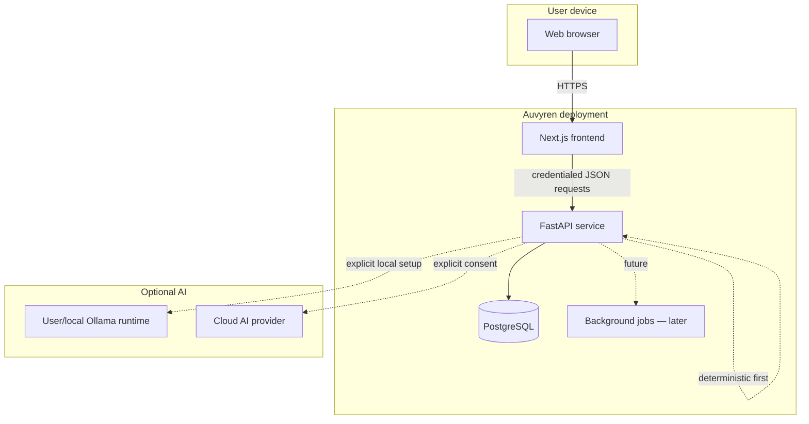

# Auvyren Architecture

**Status:** Phase 0 foundation implemented. Later-phase modules are design intent, not
shipped functionality.

## 1. Product constraints

Auvyren is a multi-user, responsive web application with these non-negotiables:

1. Real persisted data — no mock repositories or fake dashboard metrics.
2. Clear separation between user records and generated recommendations.
3. Local-first privacy: deterministic assistance works without a cloud AI subscription.
4. No personal data leaves the server for AI processing without explicit user consent.
5. Mobile-responsive, accessible interfaces with complete loading, empty, success and error states.
6. Strict phase sequencing and preservation of existing functionality.

## 2. System context



The browser is always untrusted. Authorization decisions and AI provider calls happen on
the server. The AI layer never receives data from another user's workspace.

## 3. Runtime topology

### Development

- Next.js at `http://localhost:3000`
- FastAPI at `http://localhost:8000`
- PostgreSQL in Docker, exposed on the configured host port (default 5432)
- CORS allowlist: `http://localhost:3000`
- Cookies: `SameSite=Lax`; `Secure=false` only for local HTTP development

### Production (planned, Phase 7)

- Web and API deployed as separate services.
- Recommended hostnames: `app.example.com` and `api.example.com` (same site).
- API behind TLS reverse proxy; HTTPS-only, HSTS, trusted proxy headers.
- PostgreSQL managed/private, not internet-accessible.
- Session cookie scoped to the appropriate parent domain or served through a same-origin
  proxy. Credentialed CORS remains an explicit allowlist.
- Secrets injected by the platform secret manager, never baked into images.

## 4. Repository structure and boundaries

```text
apps/web   Presentation, routing, client interaction, browser state
apps/api   HTTP transport, domain use cases, persistence, AI orchestration
docs       Decisions and operating documentation
scripts    Cross-platform local developer tooling
```

The web app contains no privileged logic. The API is the single source of truth. Shared
types are not generated yet; this is a Phase 7 improvement once the contract stabilizes.

## 5. Frontend architecture

### Rendering model

- Next.js App Router with React Server Components by default.
- Server components fetch initial authenticated data from the API.
- Client components handle immediate interactions, optimistic UI and forms.
- Static marketing pages remain static; authenticated surfaces render per user.
- `cacheComponents` is intentionally not enabled in Phase 0. Personalized dashboards and
  auth-aware layouts should not be prematurely cached. Caching will be introduced explicitly
  where safe.

### Planned feature organization

```text
src/
├── app/                    Route segments only (thin composition)
│   ├── (marketing)/
│   ├── (auth)/
│   └── (app)/
├── components/
│   ├── ui/                 Design-system primitives
│   └── layout/             Navigation, shells
├── features/
│   ├── auth/
│   ├── dashboard/
│   ├── tasks/
│   ├── goals/
│   ├── projects/
│   ├── habits/
│   ├── calendar/
│   ├── notes/
│   └── intelligence/
├── lib/
│   ├── api/                Typed API client and problem-details handling
│   └── env.ts              Validated public environment
└── styles/                 Tokens and global styles
```

Phase 0 creates only the directories with shipped files. Empty folders are not scaffolding.

### State and data fetching

- Server state comes from the API; no duplicate source of truth in client stores.
- Local UI state is colocated with components.
- A global client state library is avoided until a concrete need appears.
- API calls use the shared typed client in `src/lib/api/`, which normalizes errors.
- Optimistic updates are allowed only when the server response is authoritative and
  rollback behavior is implemented.

### Authentication at the edge

- Middleware may use cookie presence for a fast redirect, but is never the authorization
  boundary.
- The layout/server loader verifies the session with the API (`/auth/me`) for protected pages.
- The API independently authorizes every request. UI-only protection is not security.

### Styling

- Tailwind CSS v4 with CSS design tokens.
- Dark editorial palette established in Phase 0; full typography, components and motion in Phase 1.
- Minimal borders, restrained accents, no generic gradient-heavy dashboard treatment.

## 6. Backend architecture

### Layers

```text
HTTP route (FastAPI)
    ↓ validates transport input
Pydantic schema
    ↓
Domain service / use case
    ↓ owns transaction boundaries and authorization
SQLAlchemy models + async session
    ↓
PostgreSQL
```

Rules:

- Routes stay thin: parse input, call one use case, map the result, return a response.
- Services do not import FastAPI request/response objects.
- Pydantic schemas are separate from persistence models.
- Authorization is enforced in the service layer with an authenticated user context.
- Repositories are optional. They are introduced only where a domain needs a reusable query
  boundary; SQLAlchemy sessions are not hidden behind a generic abstraction.
- Transactions commit explicitly in the service or request unit of work.

### Current modules

| Area | State |
| --- | --- |
| Application factory, config, logging, errors | Implemented |
| Health/liveness/readiness | Implemented |
| Versioned API router and metadata | Implemented |
| Authentication | Tables + strategy only; Phase 2 |
| Productivity domains | Tables only; Phase 3 |
| AI providers | Design only; Phase 4 |
| Knowledge workspace | Design only; Phase 5 |
| Sync/cloud/export | Design only; Phase 6 |

### Configuration

`app/core/config.py` is the only environment reader. It:

- Loads the repository-root `.env` for local development.
- Requires a PostgreSQL URL and a secret of at least 32 characters.
- Rejects insecure production behavior (insecure cookies, placeholder secrets, wildcard CORS).
- Exposes typed settings through a cached accessor.

### Error model

- All deliberate errors raise `AppError` and become RFC 9457 problem details.
- Validation errors become `422` with per-field issues.
- Unknown routes/methods return problem details with request IDs.
- Unexpected exceptions are logged server-side and returned as generic `500` responses.
- Stack traces, SQL, file paths and secrets are never returned to clients.

### Observability

- `X-Request-ID` accepted only if well-formed; otherwise generated.
- Request IDs are attached to logs and error payloads.
- Development logs are human-readable; production logs are JSON.
- SQL echo is off unless explicitly debugging.
- Metrics, alerting and audit events are Phase 7/6 additions.

## 7. Data architecture

- PostgreSQL is the system of record.
- SQLAlchemy 2 async with asyncpg; Alembic owns schema changes.
- UUIDv4 primary keys generated by PostgreSQL (`gen_random_uuid()`).
- `timestamptz` for instants; `date` for calendar-day concepts.
- A database trigger maintains `updated_at` even for raw SQL writes.
- Soft deletion is used for tasks, projects, goals and calendar events so user content can
  be recovered. Reads must filter `deleted_at IS NULL`.
- Account deletion cascades through all owned content; export happens before deletion in Phase 6.
- Enumerations are stored as constrained lowercase strings rather than native PostgreSQL
  enums, making additive changes cheaper.

Full details: [database schema](database-schema.md).

## 8. Authentication and authorization strategy

Designed now, implemented in Phase 2:

- Opaque 256-bit session tokens, stored as SHA-256 hashes.
- HttpOnly, Secure (production), `SameSite=Lax` cookie.
- Sliding 30-day session with a 90-day absolute cap; revoke server-side.
- Argon2id password hashing.
- CSRF: session-bound token in a readable cookie plus `X-CSRF-Token` header; Origin/Referer
  checks as defense in depth.
- Generic login/forgot-password responses to avoid account enumeration.
- Password reset with single-use hashed tokens and short expiry.
- Login rate limiting and security event logging in Phase 2.
- Every product query scoped by the authenticated user; ownership checks return `404` where
  revealing existence would leak data.
- Email delivery through a console adapter in development and SMTP in production.

Details: [security](security.md).

## 9. Local-first and AI boundaries

Local-first in Auvyren means:

1. The software is self-hostable and the database is the user's durable source of truth.
2. Deterministic planning/insights run on the Auvyren server without external AI.
3. Local AI (Ollama) is optional and explicitly configured.
4. Cloud AI never receives personal context without explicit consent and is never required.
5. Offline browsing/editing is a Phase 6 capability. Phase 0 is **not** offline-capable;
   this is stated explicitly rather than implied.

A browser cannot automatically reach a user's localhost Ollama. Two supported deployment
models are documented in [AI architecture](ai-architecture.md): self-hosted Auvyren (server
can reach a local runtime) and a future desktop companion for hosted Auvyren.

## 10. Key decisions

| Decision | Rationale |
| --- | --- |
| Monorepo with independent deployables | One product history without coupling runtime deployments |
| Next.js App Router + RSC | Fast initial loads, clear route composition, server-side auth checks |
| FastAPI + SQLAlchemy async | Typed API, OpenAPI, clean async PostgreSQL access |
| Server-side opaque sessions | Immediate revocation and no token storage in browser JS |
| RFC 9457 error format | One predictable error contract for UI and future clients |
| Constrained string enums | Easier additive migrations than PostgreSQL enum types |
| Deterministic intelligence before LLM | Explainable, private, reliable core; AI is optional enhancement |
| No client-side AI keys | Prevents credential leakage and enforces consent/limits server-side |
| Docs-as-code | Every phase has explicit contracts, exit criteria and a completion report |

## 11. Future evolution and risks

| Risk | Mitigation |
| --- | --- |
| Cross-user data leaks | Enforce user scoping in services; integration tests for IDOR in Phase 7 |
| AI context leakage | Server-side consent, local-only default, redaction/minimization, provider audit |
| Schema churn | Small phased Alembic migrations with review and rollback path |
| Offline conflicts | Versioned writes and explicit sync conflict policy in Phase 6, not ad hoc LWW |
| Token/session theft | HttpOnly cookies, HTTPS, CSRF, rotation, revocation and security events |
| Hosted app cannot reach local Ollama | Clear self-hosted vs desktop-companion paths; never fake local processing |
| Scope creep | Phase gate, checklist and explicit approval before the next phase |

Phase 8 mobile clients will consume the same `/api/v1` contract with secure session storage;
no mobile work starts before the web app and deployment are stable.
