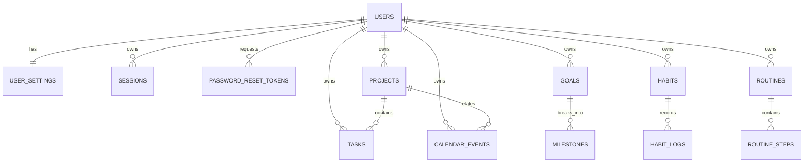

# Database Schema

**Engine:** PostgreSQL 17
**Access:** SQLAlchemy 2 async + asyncpg
**Migrations:** Alembic
**Current revision:** `c9d0e1f2a3b4` — Phase 7 search indexes and note-link constraints
**Status:** 22 application tables. Migrations apply cleanly and `alembic check` reports no
model drift against PostgreSQL 17.

## 1. Conventions

- Table and column names are `snake_case`, tables plural.
- Primary keys are UUIDv4 (`gen_random_uuid()`), except `user_settings.user_id`.
- All instants use `timestamptz`; calendar-day concepts use `date`.
- All timestamps are stored in UTC. A user's IANA timezone determines their local day.
- `created_at` and `updated_at` are non-null on mutable entities.
- An `auvyren_set_updated_at()` trigger sets `updated_at` on every UPDATE, including raw SQL.
- Enums are lowercase strings with named CHECK constraints, not native PostgreSQL enums.
- User content tables include `user_id` to make scoping unambiguous. The two intentional
  exceptions — `milestones` and `routine_steps` — are owned through their parent and must be
  authorized by joining to the parent's `user_id`.
- Soft delete (`deleted_at`) is used for projects, tasks, goals and calendar events. Queries
  must filter these rows. Sessions and habits use explicit revocation/archival instead.
- Foreign keys cascade from `users` so account deletion removes all owned data.

## 2. Entity relationship diagram

## 3. Identity and security tables

### `users`

| Column | Type | Notes |
| --- | --- | --- |
| `id` | uuid PK | `gen_random_uuid()` |
| `email` | varchar(320) | unique; stored normalized lowercase by the app |
| `password_hash` | varchar(255) | Argon2id hash from Phase 2 |
| `full_name` | varchar(120) nullable | display name |
| `is_active` | boolean | default `true` |
| `email_verified_at` | timestamptz nullable | reserved for verification flows |
| `last_login_at` | timestamptz nullable | updated on successful login |
| `created_at`, `updated_at` | timestamptz | trigger-maintained |

Constraints: `uq_users_email`, primary key. Sessions and all user content cascade on delete.

### `user_settings`

| Column | Type | Notes |
| --- | --- | --- |
| `user_id` | uuid PK/FK → `users.id` | one row per user |
| `timezone` | varchar(64) | IANA name, default `UTC` |
| `week_starts_on` | smallint | 0 = Monday … 6 = Sunday, default 0 |
| `created_at`, `updated_at` | timestamptz | |

Constraint: `week_starts_on BETWEEN 0 AND 6`.

### `sessions`

Opaque server-side sessions. The raw token is never stored.

| Column | Type | Notes |
| --- | --- | --- |
| `id` | uuid PK | |
| `user_id` | uuid FK → `users.id` | cascade |
| `token_hash` | varchar(64) | unique SHA-256 of session token |
| `csrf_token_hash` | varchar(64) | server-side CSRF secret hash |
| `user_agent` | varchar(512) nullable | diagnostics, truncate before storage |
| `ip_address` | varchar(45) nullable | IPv4/IPv6 text |
| `expires_at` | timestamptz | sliding expiry, capped absolutely in Phase 2 |
| `last_used_at` | timestamptz nullable | update throttled |
| `revoked_at` | timestamptz nullable | logout/revoke marker |
| `created_at`, `updated_at` | timestamptz | |

Index: `(user_id, expires_at)` for session listing/cleanup; unique `token_hash`.

### `password_reset_tokens`

| Column | Type | Notes |
| --- | --- | --- |
| `id` | uuid PK | |
| `user_id` | uuid FK → `users.id` | cascade, indexed |
| `token_hash` | varchar(64) | unique, single use |
| `expires_at` | timestamptz | short-lived (30 minutes planned) |
| `used_at` | timestamptz nullable | one-time enforcement |
| `created_at` | timestamptz | |

Only hashes are stored. Raw reset tokens exist only in the email link.

## 4. Productivity tables

### `projects`

| Column | Type | Notes |
| --- | --- | --- |
| `id`, `user_id` | uuid | owner cascade |
| `name` | varchar(160) | |
| `description` | text nullable | |
| `status` | varchar(20) | `active`, `paused`, `completed`, `archived` |
| `start_date`, `due_date` | date nullable | due must be ≥ start |
| `deleted_at` | timestamptz nullable | soft delete |
| `created_at`, `updated_at` | timestamptz | |

Indexes: `(user_id, status)`, `(user_id, due_date)`. Check: `dates_valid`.

### `tasks`

| Column | Type | Notes |
| --- | --- | --- |
| `id`, `user_id` | uuid | owner cascade |
| `project_id` | uuid nullable FK → `projects.id` | `ON DELETE SET NULL` |
| `title` | varchar(240) | |
| `description` | text nullable | |
| `status` | varchar(20) | `todo`, `in_progress`, `done`, `cancelled` |
| `priority` | varchar(20) | `low`, `medium`, `high`, `urgent` |
| `category` | varchar(64) nullable | user-facing label |
| `due_at` | timestamptz nullable | precise deadline |
| `planned_for` | date nullable | day the user intends to work on it |
| `estimated_minutes` | smallint nullable | must be > 0 |
| `sort_order` | integer | default 0 |
| `completed_at` | timestamptz nullable | set/cleared by service logic |
| `deleted_at` | timestamptz nullable | soft delete |
| `created_at`, `updated_at` | timestamptz | |

Indexes: `(user_id, status)`, `(user_id, planned_for)`, `(user_id, due_at)`, `project_id`.
Checks: `estimated_minutes_positive`, status/priority value checks.

### `goals`

| Column | Type | Notes |
| --- | --- | --- |
| `id`, `user_id` | uuid | owner cascade |
| `title` | varchar(200) | |
| `description` | text nullable | |
| `outcome` | text nullable | measurable success statement |
| `status` | varchar(20) | `active`, `paused`, `completed`, `archived` |
| `target_date` | date nullable | |
| `completed_at` | timestamptz nullable | |
| `manual_progress` | smallint nullable | 0–100, used when no milestones exist |
| `deleted_at` | timestamptz nullable | soft delete |
| `created_at`, `updated_at` | timestamptz | |

Indexes: `(user_id, status)`, `(user_id, target_date)`.
Goal progress is computed from milestones when present; manual progress is a fallback.

### `milestones`

| Column | Type | Notes |
| --- | --- | --- |
| `id` | uuid PK | |
| `goal_id` | uuid FK → `goals.id` | cascade |
| `title` | varchar(200) | |
| `description` | text nullable | |
| `status` | varchar(20) | `pending`, `completed` |
| `target_date` | date nullable | |
| `completed_at` | timestamptz nullable | |
| `sort_order` | integer | default 0 |
| `created_at`, `updated_at` | timestamptz | |

Index: `(goal_id, sort_order)`. No direct `user_id`; authorization joins `goals.user_id`.

### `habits`

| Column | Type | Notes |
| --- | --- | --- |
| `id`, `user_id` | uuid | owner cascade |
| `name` | varchar(160) | |
| `description` | text nullable | |
| `schedule` | varchar(20) | `daily` or `weekly` |
| `target_per_week` | smallint nullable | required 1–7 for weekly, null for daily |
| `start_date` | date | default current date; app sets in user timezone |
| `is_archived` | boolean | default false |
| `created_at`, `updated_at` | timestamptz | |

Index: `(user_id, is_archived)`.
Check: daily ⇒ target is null; weekly ⇒ target between 1 and 7.

### `habit_logs`

| Column | Type | Notes |
| --- | --- | --- |
| `id` | uuid PK | |
| `habit_id` | uuid FK → `habits.id` | cascade |
| `user_id` | uuid FK → `users.id` | cascade, denormalized for scoping |
| `log_date` | date | user's local calendar date |
| `note` | text nullable | |
| `completed_at` | timestamptz | default now |

Unique: `(habit_id, log_date)` — one entry per habit per day.
Index: `(user_id, log_date)`. Streaks and consistency are computed from logs.

### `routines`

| Column | Type | Notes |
| --- | --- | --- |
| `id`, `user_id` | uuid | owner cascade |
| `name` | varchar(160) | |
| `description` | text nullable | |
| `time_of_day` | varchar(32) nullable | e.g. morning, evening |
| `is_active` | boolean | default true |
| `created_at`, `updated_at` | timestamptz | |

Index: `(user_id, is_active)`.

### `routine_steps`

| Column | Type | Notes |
| --- | --- | --- |
| `id` | uuid PK | |
| `routine_id` | uuid FK → `routines.id` | cascade |
| `title` | varchar(200) | |
| `description` | text nullable | |
| `duration_minutes` | smallint nullable | 1–1440 |
| `sort_order` | integer | default 0 |
| `created_at`, `updated_at` | timestamptz | |

Index: `(routine_id, sort_order)`. Authorization joins `routines.user_id`.

### `calendar_events`

| Column | Type | Notes |
| --- | --- | --- |
| `id`, `user_id` | uuid | owner cascade |
| `project_id` | uuid nullable FK → `projects.id` | `ON DELETE SET NULL` |
| `title` | varchar(240) | |
| `description` | text nullable | |
| `starts_at`, `ends_at` | timestamptz | end must be after start |
| `all_day` | boolean | default false |
| `location` | varchar(240) nullable | |
| `deleted_at` | timestamptz nullable | soft delete |
| `created_at`, `updated_at` | timestamptz | |

Indexes: `(user_id, starts_at)`, `project_id`. All-day events are stored as UTC instants and
rendered in the user's timezone.

Task deadlines, goal milestones and upcoming events are combined at query time for calendar
views; they are not duplicated into `calendar_events`.

## 5. Deletion and lifecycle

| Action | Behavior |
| --- | --- |
| Delete task/project/goal/event | Soft delete via `deleted_at`; excluded from normal reads |
| Delete habit | Archive via `is_archived`; history retained |
| Revoke session | Set `revoked_at`; row retained until cleanup |
| Delete user account | Cascade: sessions, settings, projects, tasks, goals, milestones, habits, logs, routines, steps, events, reset tokens |
| Delete project | Tasks and events keep existing via `SET NULL` |
| Delete goal | Milestones cascade |
| Delete habit | Habit logs cascade |

Account export and deletion endpoints are implemented. Deletion requires a confirmation
token stored only as a hash and cascades from `users`; export metadata is recorded in
`data_exports`. Export artifact generation is not implemented, so the download endpoint never
returns a file.

## 6. Index and query strategy

- Every hot list query is anchored by `user_id`.
- Task ordering will support planned date, due date and priority; status filters use the
  composite index.
- Habit consistency queries use `(user_id, log_date)`.
- Calendar ranges use `(user_id, starts_at)`.
- Knowledge search uses `ILIKE` over title, content and tags, backed by `pg_trgm` GIN indexes
  (`ix_notes_title_trgm`, `ix_notes_content_trgm`, `ix_notes_tags_trgm`).
- Note-link edges are unique (`uq_note_links_edge`) and self-links are rejected.
- Query shape changes must be accompanied by `EXPLAIN (ANALYZE, BUFFERS)` evidence; the Phase 7
  review is recorded in `docs/reports/phase-7-performance.md`.
- No N+1 queries: async SQLAlchemy requires explicit eager loading; services must not lazily
  access relationships during serialization.

## 7. Additional implemented tables

| Phase | Table | Purpose |
| --- | --- | --- |
| 4 | `ai_provider_configs` | Per-user provider, model and local endpoint; `encrypted_secret` is reserved and currently always `NULL` |
| 4 | `ai_insights` | Generated briefings/recommendations with provider, model, provenance and dismissal |
| 4 | `ai_usage_logs` | Requests, tokens, cost and errors |
| 5 | `notes` | Unified notes, journal entries, decision records and reviews with Markdown content |
| 5 | `note_links` | Typed links between notes and goals/projects/tasks/notes |
| 6 | `ai_consents` | Per-provider consent grants and revocations |
| 6 | `data_exports` | Export request status and generated artifact metadata |
| 6 | `account_deletions` | Hashed confirmation token and deletion lifecycle |
| 6 | `audit_events` | Login, revocation, export, deletion and AI consent audit trail |

Sync device/change-log tables are **not** implemented in this release. No last-write-wins
sync policy is claimed or enforced; the mobile client (Phase 8) must not assume one.

## 8. Migration policy

1. Update SQLAlchemy models.
2. Run `alembic revision --autogenerate -m "..."` and **review every line**.
3. Add data backfills, triggers and constraints manually where autogenerate cannot infer them.
4. Test `upgrade head`, `downgrade -1`, and `alembic check` against PostgreSQL.
5. Never edit an applied migration; create a new revision.
6. Use expand/contract for breaking changes: add new shape → backfill → switch reads/writes →
   remove old shape in a later migration.
7. Record destructive or long-running migrations in the phase report.

## 9. Verification performed in Phase 0

- Initial migration applied successfully.
- Downgrade to base and re-upgrade succeeded.
- `alembic check` reports **no new upgrade operations**.
- PostgreSQL CHECK constraints confirm lowercase enum values.
- Integration tests create a user, settings, project, task, goal, milestone, habit, log and
  event, verify cascade deletion, and confirm the `updated_at` trigger.
- 14 backend tests pass against real PostgreSQL.
