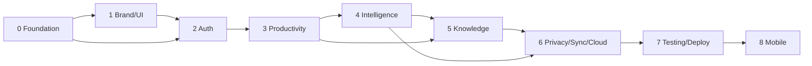

# Development Roadmap

Auvyren is built strictly phase by phase. A phase starts only after the previous phase has
passed its exit criteria and received explicit approval. The roadmap is a commitment to
sequence, not an estimate of calendar time.

## Status summary

| Phase | Name | Status |
| --- | --- | --- |
| 0 | Product Foundation & Architecture | **Complete — awaiting approval** |
| 1 | Brand Identity & UI Foundation | Not started |
| 2 | Authentication & Core Application | Not started |
| 3 | Personal Productivity System | Not started |
| 4 | Auvyren Intelligence Engine | Not started |
| 5 | Personal Intelligence & Knowledge Workspace | Not started |
| 6 | Privacy, Synchronization & Cloud AI | Not started |
| 7 | Testing, Optimization & Deployment | Not started |
| 8 | Mobile Application | Blocked by design |

## Phase 0 — Product Foundation & Architecture

**Objective:** Establish the technical foundation, contracts and schema before feature work.

Delivered:

- Monorepo, frontend/backend scaffolds, configuration and developer scripts.
- Architecture, schema, API, security and AI design documents.
- PostgreSQL schema for identity and productivity, with Alembic migration.
- Health endpoints, error contract, request IDs, security headers, CORS.
- Verification suite and Phase 0 report.

Exit criteria: application and database start successfully; migrations upgrade/downgrade;
backend tests and frontend static checks pass; documentation complete. **Met.**

## Phase 1 — Brand Identity & UI Foundation

**Objective:** Build a premium, quiet, dark editorial interface and the reusable design system.

Scope:

- Typography, spacing, color tokens, motion and interaction rules.
- Reusable primitives: buttons, inputs, selects, dialogs, menus, tabs, toasts, badges,
  empty/loading/error states, layout shells.
- Responsive navigation and dashboard/settings shells.
- Landing page, sign-in, sign-up and forgot-password screens.
- Accessibility baseline: focus states, keyboard navigation, contrast, reduced motion.

Dependencies: Phase 0 tokens and frontend structure.
Exit criteria: component catalogue, responsive screenshots at desktop/tablet/mobile, keyboard
and contrast review, zero mock authenticated data, lint/typecheck/build green. Auth screens in
this phase are visual only until Phase 2 wires them; that distinction must be explicit.

## Phase 2 — Authentication & Core Application

**Objective:** Make accounts and sessions real, secure and usable.

Scope:

- Registration, login, logout, forgot/reset password, session listing/revocation.
- Argon2id hashing, opaque sessions, HttpOnly cookies, CSRF, rate limiting.
- Profile and account settings backed by PostgreSQL.
- Protected API and web routes; generic auth errors; email console/SMTP adapters.
- End-to-end auth tests including cross-user isolation and session revocation.

Dependencies: Phase 1 forms/components; Phase 0 user/session schema.
Exit criteria: no hardcoded credentials; auth flows work against PostgreSQL; security tests
pass; docs updated; completion report. No productivity features are started early.

## Phase 3 — Personal Productivity System

**Objective:** Implement the daily operating system with real persistence.

Scope:

- Dashboard: today, upcoming, goals, habits, daily overview, deterministic insights.
- Tasks: CRUD, priorities, deadlines, categories, completion, search/filter.
- Goals and milestones with computed progress.
- Projects with task association, status and deadlines.
- Habits, completion logs, streaks and weekly consistency; routines.
- Calendar month/week/day views combining deadlines, milestones and events.
- Full loading, empty, success and error states; responsive layouts.

Dependencies: authenticated user context; Phase 1 components; Phase 0 schema.
Exit criteria: every module persists via the API; authorization tests for each resource;
dashboard derives from real records; no static/mock data; completion report.

## Phase 4 — Auvyren Intelligence Engine

**Objective:** Add explainable assistance without making AI mandatory.

Scope:

- Deterministic prioritization, deadline awareness, workload analysis, goal/habit analysis,
  daily plan, pattern detection.
- Provider abstraction: deterministic, local Ollama, cloud interface stub.
- Local runtime configuration, connection test, model discovery and selected model.
- Daily briefing and workspace Q&A using minimized user context.
- Provenance labels and deterministic fallbacks.
- Honest handling of browser-to-localhost limitation; no fake local processing.

Dependencies: Phase 3 real data; AI architecture.
Exit criteria: deterministic engine unit tests; local provider works or degrades clearly;
no cloud calls; consent boundary documented; completion report.

## Phase 5 — Personal Intelligence & Knowledge Workspace

**Objective:** Connect plans, reflection and knowledge.

Scope:

- Notes and knowledge library with search.
- Daily journal, decision records, weekly and monthly reviews.
- Links between notes, goals, projects and tasks.
- Generated summaries/reviews clearly distinguished from user-authored records.
- Neglected goals, approaching deadlines, habit inconsistency and overload detection.
- Review workflows that convert insights into actionable records on request.

Dependencies: Phase 3 data; Phase 4 intelligence and provenance.
Exit criteria: note CRUD/search; associations enforce ownership; reviews use real data;
generated content labelled; completion report.

## Phase 6 — Privacy, Synchronization & Cloud AI

**Objective:** Complete the optional hybrid architecture and user data controls.

Scope:

- AI consent UI/API, local/cloud indicators, encrypted cloud keys, usage limits, cost tracking.
- Server-side cloud provider, local-only/hybrid modes, no silent transmission.
- Data export and account deletion.
- Sync: supported entities, conflict handling, status indicators, offline-friendly client
  queue where feasible.
- Audit/security events and data isolation verification.

Dependencies: stable Phase 3–5 data model; AI provider abstraction.
Exit criteria: consent tests prove no cloud calls without permission; export/deletion verified;
sync conflict policy documented and tested; cloud optional; completion report.

## Phase 7 — Testing, Optimization & Deployment

**Objective:** Make Auvyren safe and operable for real users.

Scope:

- Component, API, auth, database, AI-provider, permission, responsive and end-to-end tests.
- Performance budgets, query/index review, loading states, error handling.
- Accessibility and security review; CSP; dependency audit; rate limits; backups.
- Deploy Next.js, FastAPI and PostgreSQL; environment/secrets; logging, monitoring, alerts.
- Deployment runbook, backup/restore drill, incident notes.

Dependencies: all web product phases.
Exit criteria: CI green, production deployment healthy, restore drill passed, security checklist
complete, no critical accessibility issues, completion report.

## Phase 8 — Mobile Application (future)

**Objective:** Extend Auvyren to Android and iOS with Flutter.

Scope: dashboard, tasks, goals, habits, notes, AI briefing, notifications, synchronization,
secure authentication.

Gate: web application and backend are stable and deployed; API contract versioned; sync is
tested. Phase 8 must not begin before Phase 7 approval. No separate AI behavior or consent
model — mobile uses the same server-side provider and permissions architecture.

## Dependencies and sequencing

## Cross-phase rules

1. Inspect the current implementation before changing it.
2. Preserve working functionality and existing user data.
3. Real backend persistence; no mock data in production paths.
4. Secrets remain server-side.
5. Every mutation has authorization, validation, loading/error states and tests.
6. Generated AI content is visually and structurally distinct from user records.
7. Documentation and a completion report accompany every phase.
8. Stop after each phase for explicit approval.
